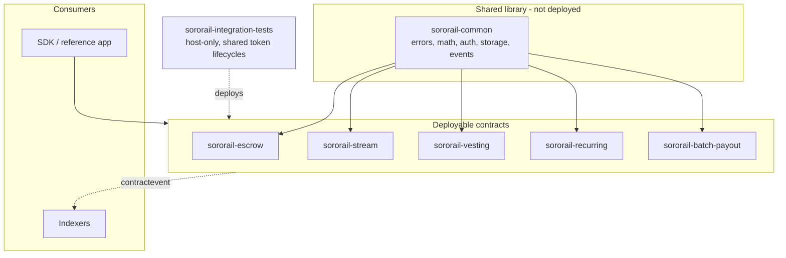

# Architecture

How the crates in this repository fit together, and the four models that every
contract follows: storage, authorization, TTL, and errors. This is the map to
read before changing a contract; the per-contract flows are in
[fund-flows.md](fund-flows.md), and the event schema is in
[events.md](events.md).

## The shape of the workspace



`contracts/common` is a library, not a contract. It owns the pieces that must be
identical in every contract: the error enum and its numbering, checked money
math, authorization guards, TTL constants and the single-position storage
macro, plus the normative event convention. A behaviour that belongs to all
five contracts belongs there; a behaviour specific to one belongs in that
contract's crate. The `sororail-integration-tests` crate is host-only — it needs
`std` for `testutils` — and is excluded from wasm builds.

## One position per deployed instance

Every stateful contract holds **exactly one position per deployment**: one
escrow, one stream, one vesting grant, one recurring authorization. Entry-point
signatures take no position id, and storage uses a single fixed key.

This is deliberate and it is the most important thing to know as an integrator:
to hold two streams, deploy two contract instances. It keeps entry points small
and the authorization rules easy to audit, at the cost of one deployment per
position. `batch_payout` is stateless and does not even have that: each call is
independent and the contract holds no funds between calls.

An id-keyed, multi-position design would need persistent storage keys, a
position-id topic on events, and different authorization rules. It is discussed
as a future direction in [../SPEC.md](../SPEC.md); it is not a drop-in change.

## Storage model

All persisted state lives in **instance storage**, addressed by a per-crate
`DataKey` enum. There is no persistent or temporary storage in use today.

Each stateful crate's `storage.rs` invokes the shared macro:

```rust,ignore
impl_single_position_storage!(YourType, DataKey::YourKey);
```

which generates four helpers:

| Helper | Behaviour |
|---|---|
| `is_initialized(&Env)` | Returns whether the key exists. |
| `load(&Env)` | Reads the value **and extends the instance TTL**; errors with `NotInitialized` when absent. |
| `load_view(&Env)` | Reads the value without touching ledger state; same error when absent. |
| `save(&Env, &value)` | Writes the value **and extends the instance TTL**. |

Mutating entry points use `load`/`save`; read-only views use `load_view`, so
polling a contract costs no ledger write. The shared macro means a new contract
cannot forget the TTL extension. `batch_payout` has no `storage.rs` because it
persists nothing.

Persistent TTL helpers are reserved in `sororail_common::storage` for the
future id-keyed design and are intentionally not shipped yet.

## Authorization model

Authorization is the widest attack surface in Soroban contracts, so the rule is:
**check membership before calling `require_auth`.** Asking an unrelated address
for a signature first prompts a wallet for a decision it has no business
making. The guards in `sororail_common::auth` enforce the order:

- `require_auth_as(caller, expected)` — one permitted party.
- `require_auth_either(caller, a, b)` — two fixed parties.
- `require_auth_either_opt(caller, a, optional_b)` — a party plus an optional
  one, used for "depositor or the configured arbiter".

There are two entry-point shapes, chosen by how many parties may call:

1. **One fixed party:** no `caller` argument. The contract already knows the
   address and calls `require_auth` on the stored field — for example
   `stream::withdraw` on the stored recipient, or `vesting::claim`. An
   `Unauthorized` error is unreachable here and is correctly absent from those
   error tables.
2. **Several permitted parties:** accept `caller: Address`, run the matching
   guard, then record who acted in the event (`released_by`, `cancelled_by`,
   `raised_by`). Used by `escrow`'s release/refund/dispute paths and by
   `recurring::cancel`.

`recurring` adds a second authorization layer: the payer approves the contract
as a spender on the SEP-41 token, and each `charge` moves funds with
`transfer_from` within the payer's cap and cadence. Cancelling the authorization
does not by itself revoke the token allowance. Every privileged entry point has
a test asserting that a wrong caller is rejected; see
[CONTRIBUTING.md](../CONTRIBUTING.md) for the conventions new entry points must
follow.

## TTL model

Soroban archives a ledger entry whose time-to-live reaches zero. The constants
live in `sororail_common::storage`:

| Constant | Value | Meaning |
|---|---|---|
| `DAY_IN_LEDGERS` | 17,280 | One day at the ~5 s close time. |
| `INSTANCE_BUMP` | 30 × 17,280 | TTL applied to the instance and its code. |
| `INSTANCE_THRESHOLD` | 29 × 17,280 | Renew once fewer than 29 days remain. |

Because `load` and `save` call `extend_instance`, any successful mutation
renews the position. A long-lived but idle position still needs an explicit,
permissionless `bump()` entry point roughly every 28 days, paid for by whoever
calls it. `batch_payout` has no persisted position and therefore no `bump`.
If an instance has already been archived, it must be restored through the
network's archival restoration flow before `bump()` can run.

The operator schedule, retry behaviour and recovery details are in
[TTL_STRATEGY.md](TTL_STRATEGY.md).

## Error numbering

There is one shared `sororail_common::errors::Error` enum; each contract's
`errors.rs` re-exports it. Clients decode failures by integer, so the numbers
are ABI: a released variant is never renumbered, removed, or reused. The
ranges are reserved per owner:

| Owner | Codes |
|---|---|
| generic | 1–15 |
| escrow | 20–27 |
| stream | 40–44 |
| vesting | 60–66 |
| recurring | 80–83 |
| batch_payout | 100–101 |

Code 102 (`BatchDuplicateRecipient`) was burned before release and stays
unassigned. The canonical variant-to-code table is
[ERRORS.md](ERRORS.md), checked against the source in CI.

## Events as the integration boundary

Events are the other half of the public surface. Every event uses fixed topics
`[contract, action]` followed by the attributed address, with amounts always in
the data payload. `sororail_common::events` documents the convention and
`tests/tests/event_topics.rs` enforces it; [events.md](events.md) lists all 21
events with their topics and fields. Indexers should filter on the contract
topic and join token `transfer` events in the same transaction for per-party
amounts.
