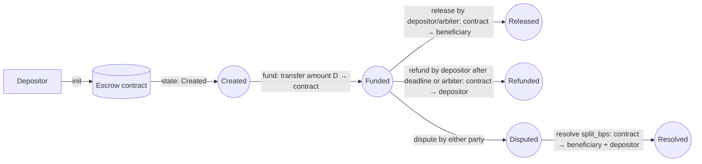
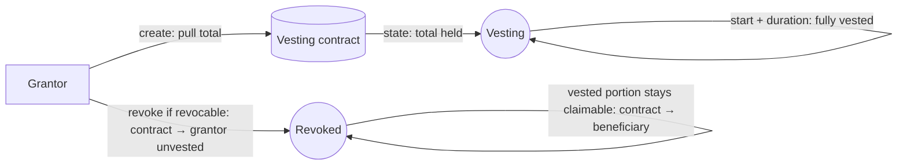
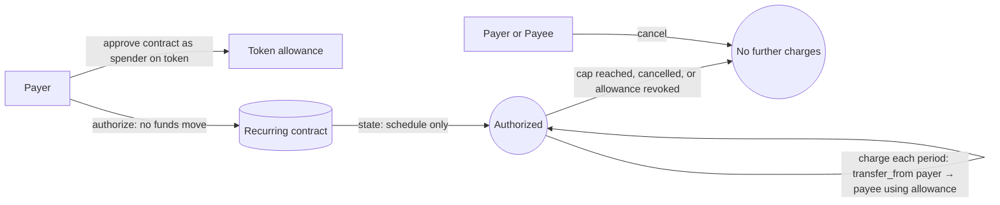
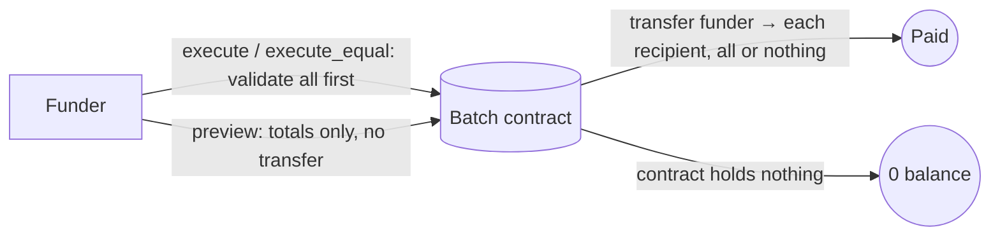

# Fund Flows

One Mermaid diagram per contract. Each diagram shows token movement only;
state transitions are labelled with the entry point that causes them. All
contracts are one-instance-per-deployment and hold the token in the contract
account only where stated.

## Escrow



Verified by `contracts/escrow/src/test/{init,fund,release,refund,dispute,resolve}.rs`:
`fund_moves_the_tokens_into_the_contract`, `release_pays_the_beneficiary`,
`refund_by_depositor_succeeds_after_the_deadline`,
`dispute_is_callable_by_either_party`, `resolve_conserves_the_escrowed_amount_at_every_split`.

## Stream

```mermaid
flowchart LR
    Sender -->|create: pull rate × (stop - start)| C[(Stream contract)]
    C -->|state: deposited held| A((Streaming))
    A -->|withdraw: contract → recipient accrued − withdrawn| A
    Sender -->|top_up / extend: pull additional funds| A
    A -->|cancel if cancellable: contract → recipient settled + sender refund| X((Cancelled))
    A -->|stop reached: accrual ends, remainder still withdrawable| A
```

Verified by `contracts/stream/src/test.rs`:
`create_funds_the_whole_span_up_front` (create pull),
`withdraw_none_takes_everything_available`,
`top_up_extends_the_stop_by_the_span_it_buys`,
`extend_pulls_the_funds_the_longer_span_requires`,
`cancel_settles_the_recipient_and_refunds_the_sender`, and the conservation
property asserted by `assert_conserved` throughout.

## Vesting



Verified by `contracts/vesting/src/test/{create,claim,revoke,conservation}.rs`:
`create_funds_the_whole_grant_up_front`, `claim_pays_the_vested_portion`,
`revoke_returns_only_the_unvested_portion`,
`the_vested_portion_stays_claimable_after_revocation`,
`conservation_holds_across_claim_then_revoke_then_claim`.

## Recurring



Verified by `contracts/recurring/src/test.rs`:
`authorize_schedules_the_first_charge_one_period_out`,
`charge_moves_funds_from_payer_to_payee`,
`skipped_periods_are_forfeited_not_banked`,
`charge_stops_at_the_cap`,
`charge_fails_once_the_payer_revokes_the_allowance`,
`the_payer_can_cancel`.

## Batch payout



Verified by `contracts/batch_payout/src/test.rs`:
`execute_pays_each_recipient_their_own_amount`,
`execute_equal_pays_everyone_the_same`,
`a_batch_the_funder_cannot_afford_pays_nobody`,
`execute_reverts_cleanly_when_a_transfer_fails`,
`preview_totals_without_moving_anything`.
